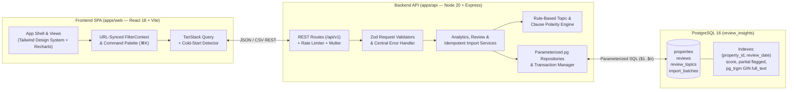

# Review Insights Dashboard

A full-stack hospitality analytics platform that transforms guest reviews across **4 European hotel properties** into actionable operational intelligence: executive KPIs, longitudinal score/volume trends, score histograms, rule-based topic sentiment analysis, multi-property radar comparison, an operational flagged-reviews recovery queue, and idempotent CSV/JSON imports.

> **Important Data Provenance Notice:**  
> This application **does not scrape Booking.com or any third-party website**. All preloaded data (~620 reviews spanning 18 months across 4 fictional hotels) is synthetically generated by a deterministic Mulberry32 PRNG seed script ([apps/api/src/db/seedData.ts](apps/api/src/db/seedData.ts)), and new data can be loaded via the drag-and-drop CSV/JSON import UI (`POST /api/v1/imports`).

---

## Live Demo & Screenshots

- **Live Frontend (Vercel):** `https://<your-vercel-domain>.vercel.app` *(update after deploying with [docs/DEPLOYMENT.md](docs/DEPLOYMENT.md))*
- **Live API & Swagger Docs (Render):** `https://<your-render-service>.onrender.com/api/docs`

### Screenshots

> *(Replace these placeholders with screenshots of your running app before final submission)*

| Executive Overview (Light Mode) | Executive Overview (Dark Mode) |
| --- | --- |
|  |  |

| Topic Sentiment Insights | Reviews Explorer & Detail Drawer |
| --- | --- |
|  |  |

| Multi-Property Comparison Radar | Flagged Reviews Action Queue |
| --- | --- |
|  |  |

---

## System Architecture



---

## Tech Stack & Engineering Trade-offs

| Layer | Choice | Why & Trade-offs |
| --- | --- | --- |
| **Monorepo** | Native **npm workspaces** (`apps/api`, `apps/web`) | Built into Node 20 with zero extra tooling in Docker or GitHub Actions CI. Shared strict TypeScript baseline (`tsconfig.base.json`). |
| **Database & Queries** | **PostgreSQL 16** + raw `pg` pool + `node-pg-migrate` | Avoids heavy ORM abstraction overhead. Gives direct access to PostgreSQL `FILTER (WHERE ...)`, `DATE_TRUNC`, `pg_trgm` GIN trigram search indexes, and partial indexes. Trade-off: SQL queries are written and typed explicitly in repositories. |
| **Topic & Sentiment NLP** | **Deterministic Keyword + Clause Polarity Lexicon** | Zero external LLM latency/cost and 100% reproducible results. Splits reviews on contrast conjunctions (`but`, `however`, `although`) and applies a 3-word negation lookbehind window. Trade-off: Cannot catch subtle sarcasm or implicit complaints without domain keywords. |
| **Frontend State** | **TanStack Query v5** + **React Router URL Search Params** | Server cache invalidation on review resolution/import is declarative, while URL-synced filters make every filtered view shareable and reload-safe. |
| **Design System** | **Tailwind CSS** + **CSS Custom Properties** + **Radix UI** | Semantic tokens (`--bg-canvas`, `--bg-surface`, `--sentiment-pos/neu/neg`) power instant Light/Dark switching, theme-aware Recharts, and accessible keyboard dialogs (`⌘K` Command Palette, Detail Drawer, Import Modal). |

---

## Quick Start (Local Development with Docker Compose)

Everything works from a fresh clone using Docker Compose:

```bash
# 1. Copy environment variables
cp .env.example .env

# 2. Build and start PostgreSQL 16, Express API, and Nginx/React Web containers
docker compose up --build -d

# 3. Install workspace dependencies locally (for running seed, lint, and tests)
npm install

# 4. Seed the 4 European hotel properties and ~620 realistic guest reviews
npm run db:seed
```

> **Note on Host PostgreSQL Port (`54320`):**  
> To avoid colliding with any pre-installed local PostgreSQL service on host port `5432`, `docker-compose.yml` maps the database container to **`localhost:54320`** on the host (`54320:5432`), while containers communicate internally over `db:5432`.

### Local Service URLs
- **Frontend Web App:** [http://localhost:5173](http://localhost:5173)
- **API Health Check:** [http://localhost:4000/health](http://localhost:4000/health)
- **Interactive OpenAPI / Swagger Docs:** [http://localhost:4000/api/docs](http://localhost:4000/api/docs)
- **Hot-Reload Dev Servers (Optional):** Run `npm run dev:api` and `npm run dev:web` during active code editing.

---

## The 4 Seeded Hotel Properties

The seed script ([apps/api/src/db/seedData.ts](apps/api/src/db/seedData.ts)) uses a seeded Mulberry32 PRNG to generate **620 realistic reviews** (155 per property) over 18 months across 18 guest nationalities and 5 trip types, each with a distinct operational profile:

1. **Canal House Boutique Amsterdam** (`amsterdam-canal-house`, 4★, 48 rooms) — Praised for canal location and warm staff; critiqued for smaller historic rooms and weekend street noise.
2. **Sol Mar Beach Resort Barcelona** (`barcelona-beach-resort`, 5★, 180 rooms) — High leisure/family volume, praised for beachfront views and breakfast buffet; critiqued for peak-season value.
3. **Mitte Executive Hotel Berlin** (`berlin-business-hotel`, 4★, 210 rooms) — Heavy business traveler mix, praised for ultra-fast Wi-Fi, cleanliness, and soundproofing; mixed scores on front-desk warmth and breakfast crowding.
4. **Alpine View Lodge Zurich** (`zurich-alpine-lodge`, 5★, 75 rooms) — Highest overall rating (cleanliness, room comfort, quietness); critiqued for Swiss pricing (`value`) and mountain annex Wi-Fi signal.

---

## REST API Summary (`/api/v1`)

Full interactive documentation is served at `/api/docs` (raw spec at `/api/docs/openapi.json`).

| Method & Path | Description |
| --- | --- |
| `GET /health` & `GET /api/v1/health` | Service and PostgreSQL connection health probe (`200 OK` / `503`). |
| `GET /api/v1/properties` | Lists all 4 hotel properties with city, country, star rating, and room count. |
| `GET /api/v1/analytics/overview` | Portfolio & per-property KPIs (avg score, total reviews, `% pos/neu/neg`, response rate, period-over-period deltas, monthly sparklines). |
| `GET /api/v1/analytics/trends` | Time-series average score and sentiment-stacked volume (`granularity=monthly\|weekly`). |
| `GET /api/v1/analytics/distribution` | 1–10 score histogram buckets, trip-type breakdown, and top guest origin countries. |
| `GET /api/v1/analytics/topics` | Rule-based sentiment metrics across all 8 topics, plus ranked top strengths and weaknesses with guest quote snippets. |
| `GET /api/v1/analytics/comparison` | Side-by-side metrics and Recharts radar series for 2–4 selected properties. |
| `GET /api/v1/reviews` | Server-side paginated explorer with `pg_trgm` search, topic/sentiment/tripType/score/date filters, and sort. |
| `GET /api/v1/reviews/export.csv` | Streams an RFC-4180 CSV download of the current filtered review query. |
| `GET /api/v1/reviews/flagged` | Operational action queue of flagged low-score reviews with open/resolved counts. |
| `GET /api/v1/reviews/:id` | Full review detail including topic tags, matched keywords, and evidence snippets. |
| `PATCH /api/v1/reviews/:id/resolve` | Marks a review as resolved/unresolved and persists `resolved_notes` in PostgreSQL. |
| `POST /api/v1/imports` | Rate-limited, idempotent multipart `.csv`/`.json` file upload (or JSON body) with row-level validation error report. |
| `GET /api/v1/imports` | Audit log of recent import batches (`importedRows`, `duplicateRows`, `failedRows`, `errors`). |

---

## How the Topic & Sentiment Engine Works (and Its Honest Limits)

Implemented in [apps/api/src/services/topicAnalyzer.ts](apps/api/src/services/topicAnalyzer.ts):

1. **Overall Review Sentiment (1.0–10.0 Scale)**:
   - **Positive**: `score >= 8.0`
   - **Neutral**: `6.0 <= score < 8.0`
   - **Negative**: `score < 6.0`
2. **Clause Segmentation**: Reviews often contain mixed sentiment in a single sentence (e.g., *"Staff were super friendly, but the wifi was terrible"*). The analyzer splits text on both sentence punctuation (`. ! ? ;`) and contrast conjunctions (`but`, `however`, `although`, `though`, `yet`), tracking whether text came from `positive_comment` (`+1.25` bias) or `negative_comment` (`-1.25` bias).
3. **8-Topic Keyword Dictionary + Negation Lookbehind**: Each clause is matched against whole-word expressions for `cleanliness`, `staff`, `location`, `breakfast`, `wifi`, `noise`, `value`, and `room_comfort`. Polarity combines topic-specific phrase rules with a general sentiment lexicon and a **3-word negation lookbehind window** (`not`, `no`, `never`, `hardly`, `barely`, `wasn't`), so *"not clean"* flips to negative and *"no street noise"* flips to positive.
4. **Honest Limitations**:
   - **Sarcasm & Irony**: Phrases like *"Oh great, another cold shower"* may trigger positive token matches if no negative phrase rule overrides them.
   - **Implicit Mentions**: A comment like *"We couldn't sleep until 3 AM because of the bar downstairs"* will only match `noise` if at least one keyword from the noise lexicon (`noise`, `loud`, `kept us awake`, `thin walls`, etc.) appears.
   - **Multilingual Reviews**: The lexicon is currently English-only.

---

## Testing & Quality Assurance

Run the full quality suite from the repository root:

```bash
# ESLint (zero `any` rules enforced across api and web)
npm run lint

# Strict TypeScript compiler checks
npm run typecheck

# Vitest unit, Supertest database integration, and React Testing Library suites
npm test
```

- **Topic Engine Unit Tests** ([apps/api/src/__tests__/topicAnalyzer.test.ts](apps/api/src/__tests__/topicAnalyzer.test.ts)): Tests 1–10 sentiment classification, mixed-clause topic separation, negation inversion, SHA-256 content hash normalization, and auto-flagging criteria.
- **Import Integration Tests** ([apps/api/src/__tests__/import.integration.test.ts](apps/api/src/__tests__/import.integration.test.ts)): Tests JSON import, idempotent duplicate skipping, multipart CSV upload with row-level error reports, and unsupported file rejection against `review_insights_test`.
- **Analytics & Explorer Integration Tests** ([apps/api/src/__tests__/analytics.integration.test.ts](apps/api/src/__tests__/analytics.integration.test.ts)): Tests all `/api/v1/properties`, `/api/v1/analytics/*`, `/api/v1/reviews/*`, flagged resolution persistence, CSV export, and OpenAPI spec endpoints.
- **Frontend Component Tests** ([apps/web/src/__tests__/components.test.tsx](apps/web/src/__tests__/components.test.tsx)): Tests `KpiCard` deltas/sparklines, `ScoreBadge`, `TopicPill`, and `HighlightText` search match highlighting.

---

## Deployment

See [docs/DEPLOYMENT.md](docs/DEPLOYMENT.md) for step-by-step instructions to deploy PostgreSQL on **Neon**, the Dockerized API on **Render** ([render.yaml](render.yaml)), and the React SPA on **Vercel** ([vercel.json](vercel.json)).

---

## Known Limitations & What I'd Do Next

- **Authentication & Role-Based Access Control (RBAC)**: Currently public for trial evaluation; next step is adding JWT/OAuth session auth with property-manager vs. regional-director roles.
- **Multilingual & Embedding-Assisted Topic Tagging**: Augment the fast rule-based engine with an optional background worker using multilingual sentence embeddings for non-English reviews.
- **Automated Email / Slack Alerts on Flagged Reviews**: Trigger webhook notifications when a review scoring `< 5.0` on `cleanliness` or `staff` is imported.
- **Cursor-Based Pagination for 100k+ Reviews**: Replace `OFFSET` pagination with keyset pagination (`(review_date, id) < ($1, $2)`) as dataset volume scales past 100,000 rows.
